# dsh-nextsteps

English · [Português (Brasil)](README.pt-BR.md) · [简体中文](README.zh-CN.md)

[](https://www.npmjs.com/paceage/dsh-nextsteps) [](LICENSE) [](https://github.com/deepseek-ai/deepseek-harness)

**Every finished agent turn ends with ready-to-click next steps.**

`dsh-nextsteps` is a [DeepSeek Harness](https://github.com/deepseek-ai/deepseek-harness) plugin that suggests about three followup prompts at the end of every turn, renders them as clickable cards under the completed turn, and sends the clicked prompt as your next message — one click, zero typing. `Auto` lets the answering model write them; an explicit language makes the plugin produce them with its own clean model call, so the cards stay in that language even when the conversation is in another one.

```
dsh plugin --profile web add dsh-nextsteps
```

## Product tour



1. Ask anything. In `Auto` the model writes the cards itself, as the last step before its final answer; with an explicit language or model the plugin generates them after the turn instead.
2. The completed turn renders its own suggestion cards — attributed to that turn, never repeated across messages.
3. Click a card: the prompt is sent verbatim as your next queued message and the card flips to a sent state.
4. Each card also carries an action bar: copy, favourite, edit, discard and expand. Expand reveals the full prompt without sending anything.
5. Everything survives restarts: cards, their turn attribution, and which ones you already clicked.
6. Open the dsh settings → **Nextsteps** to pick the generation language (15 languages or Auto), how many suggestions you get per turn (1–6), the suggestion styles, the generation mode, the latency budget, the suggestion length and whether the small header shows.

## Features

- Per-turn attribution — suggestions stay attached to the turn that produced them, across reloads and app restarts.
- One-click send through the session's own conversation controller, with a composer fallback.
- Persistent captures: clicked cards stay marked after restarts (content-addressed keys, turn backfilled from history).
- Labels, with automatic truncation when absent; strict payload validation with corrective model feedback.
- **Suggestion styles** — a multi-select of *Next action*, *Explore* and *Deep dive*. The generator is told to vary the prompts across the selected angles; the default is all three.
- **On-demand generation** — choose `On demand` and the model is told not to call the tool; a **Generate suggestions** button under the answer asks for the cards instead. The button is there in both the inline and the host mode, and it asks the host exactly once.
- **Copy** a suggestion with one click, straight to the clipboard.
- **Favourites** — keep the suggestions you want to reuse, and copy or remove them from the settings page.
- **Discard** a suggestion you do not want, and **restore** the most recent discard; the discard list lives in the settings page too.
- **Edit** a suggestion before sending it: the edited text is what gets sent, and the stored card is left untouched.
- **Expand** a suggestion to read the full prompt without sending it.
- **Add a suggestion** by hand under the answer, next to the header.
- **Keyboard shortcuts**, local to the card: `c` copies, `f` favourites, `e` edits, `d` discards and `Esc` closes the editor or the expansion. The hints appear when the card has the focus; `Enter` and `Space` send the card as usual.
- **A live region** announces each action to screen readers, and the same text is shown next to the cards so nothing is announced silently.
- **Performance metrics** in the settings — the average and the worst duration of the generation, the capture and the card build, with the sample count; a stage with no samples says so instead of showing a fake zero.
- **A latency budget** for the generator (5 000–120 000 ms) and a bounded suggestion length (60–600 characters), so a slow model cannot hold a turn forever.
- An incremental capture history: each session keeps its own key and an index tracks the order, so a session you never open is never read.
- Settings page inside the dsh settings — language, followups per turn, styles, generation mode, latency budget, suggestion length, header visibility, metrics, favourites, discards, updates.
- An explicit language (or an explicit model) switches to a separate clean model call, so the cards hold that language even in a conversation written in another one; `Auto` with no model follows the conversation inside the turn.
- In-app updater — version check, one-click install, release notes, restart prompt.
- UI in English, Português (Brasil) and 简体中文.

## Keyboard shortcuts and the live region

The shortcuts are **local to the card** — they work when a card has the focus, and they never change what another part of the chat does. `c` copies the prompt, `f` toggles the favourite, `e` opens the editor, `d` discards the card and `Esc` closes the editor or collapses the expansion. A shortcut is ignored while the editor has the focus and whenever a modifier key is held, so the usual editing keys keep working. The hint row appears under the card when it is focused, and every action button carries an `aria-keyshortcuts` attribute so the shortcut is announced too.

Each action writes its outcome into one live region — a single element with `role="status"` whose text changes — and the same text is shown next to the cards. That is why copying, favouriting, discarding, editing and restoring are all announced once, and why a failed copy tells you it failed instead of looking like a success.

## How the language is enforced

- `Auto` with no model keeps the cards inside the turn: the answering model writes them in the conversation language.
- Any other choice (an explicit language, or an explicit model) moves the cards to a separate clean model call with its own system prompt. The transcript there is data, not instructions, so the cards keep the chosen language even when the conversation is written in another one.
- For Simplified Chinese, Japanese, Korean, Russian, Arabic and Hindi the plugin checks the script of the answer. A reply with none of the target script's characters is discarded — you get no cards rather than cards in the wrong language.
- If generation fails, no card appears and the reason is written once to the dsh log. Nothing is inserted into the chat.
- With no model selected, the cards use the chat's default model.

The turn still ends with the answer after the tool call, and the plugin adds no to-do nudge and no call cap.

## Settings

Open the dsh settings and find the **Nextsteps** section:

| Setting | What it does |
| --- | --- |
| Language | The language of the followups. `Auto` follows the conversation; any other choice is enforced by a separate clean model call. |
| Model | The model that generates the suggestions. `Auto` uses the chat's model inside the turn; an explicit language or model uses a separate call. |
| Followups per turn | How many suggested prompts are produced (1–6). |
| Suggestion styles | The angles the suggestions should cover: *Next action*, *Explore*, *Deep dive*. Any combination; the default is all three. |
| Generation | `Auto` suggests the followups when the turn ends; `On demand` waits for you to press the button under the answer. |
| Latency budget | How long the generator may run before the request is given up (5 000–120 000 ms). |
| Suggestion length | How long a single prompt may be (60–600 characters). |
| Show header | The small label above the cards. |

The same page also shows the **performance** table (generation, persistence and rendering, with the average, the worst and the sample count), your **favourites** (copy or remove them) and the **discarded** suggestions (restore them). Those three live only on your machine — they are never sent to the host as settings.

## Updates

The same settings page checks GitHub for new releases. When a newer version is published on npm, **Update now** installs it through the dsh plugin manager and asks you to restart. Updates only ever install the `dsh-nextsteps` npm package — a renamed or development copy is detected and left alone.

## Requirements

- DeepSeek Harness 0.2.x (desktop, web profile).
- Node.js 20+.

## License

[MIT](LICENSE)
