# dsh-nextsteps

[English](README.md) · Português (Brasil) · [简体中文](README.zh-CN.md)

[](https://www.npmjs.com/package/dsh-nextsteps) [](LICENSE) [](https://github.com/deepseek-ai/deepseek-harness)

**Cada turno concluído do agente termina com próximos passos prontos para clicar.**

`dsh-nextsteps` é um plugin do [DeepSeek Harness](https://github.com/deepseek-ai/deepseek-harness) que sugere cerca de três prompts de followup ao final de cada turno, renderiza-os como cards clicáveis sob o turno concluído e envia o prompt clicado como sua próxima mensagem — um clique, zero digitação. Em `Automático` o próprio modelo que responde os escreve; com um idioma explícito o plugin os produz numa chamada limpa própria, então os cards ficam nesse idioma mesmo quando a conversa está em outro.

```
dsh plugin --profile web add dsh-nextsteps
```

## Tour do produto



1. Pergunte qualquer coisa. Em `Automático` o próprio modelo escreve os cards, como último passo antes da resposta final; com um idioma ou modelo explícito, o plugin os gera depois do turno.
2. O turno concluído renderiza seus próprios cards de sugestão — atribuídos àquele turno, nunca repetidos entre mensagens.
3. Clique num card: o prompt é enviado literalmente como sua próxima mensagem na fila e o card muda para o estado de enviado.
4. Cada card tem também uma barra de ações: copiar, favoritar, editar, descartar e expandir. Expandir revela o prompt completo sem enviar nada.
5. Tudo sobrevive a restarts: os cards, a atribuição de turno e os que você já clicou.
6. Abra as configurações do dsh → **Nextsteps** para escolher o idioma de geração (15 idiomas ou Automático), quantas sugestões por turno (1–6), os estilos de sugestão, o modo de geração, o orçamento de latência, o tamanho da sugestão e se o pequeno cabeçalho aparece.

## Funcionalidades

- Atribuição por turno — as sugestões ficam ligadas ao turno que as gerou, através de reloads e restarts do app.
- Envio com um clique pelo próprio controlador de conversa da sessão, com fallback pelo composer.
- Capturas persistentes: cards clicados continuam marcados após restarts (chaves endereçadas por conteúdo, turno retro-preenchido do histórico).
- Rótulos com truncamento automático quando ausentes; validação estrita do payload com feedback corretivo ao modelo.
- **Estilos de sugestão** — uma seleção múltipla entre *Próxima ação*, *Explorar* e *Aprofundar*. O gerador recebe a instrução de variar os prompts entre os ângulos escolhidos; o padrão são os três.
- **Geração sob demanda** — escolha `Sob demanda` e o modelo recebe a instrução de não chamar a tool; um botão **Gerar sugestões** sob a resposta pede os cards. O botão existe nos dois modos, o inline e o do host, e pede ao host exatamente uma vez.
- **Copiar** uma sugestão com um clique, direto para a área de transferência.
- **Favoritos** — guarde as sugestões que quer reutilizar, e copie ou remova-as pela página de configurações.
- **Descartar** uma sugestão que você não quer, e **restaurar** o descarte mais recente; a lista de descartes também vive na página de configurações.
- **Editar** uma sugestão antes de enviá-la: o texto editado é o que é enviado, e o card guardado continua intacto.
- **Expandir** uma sugestão para ler o prompt completo sem enviar nada.
- **Testar modelo** — um botão ao lado da configuração de Modelo que sonda o modelo escolhido com uma única chamada de streaming mínima e mostra o tempo até o primeiro token, ou a falha inline.
- **Exportar** os favoritos como um download em Markdown, na ordem em que cada um foi salvo.
- **Nova conversa com esta sugestão** — uma ação do card que abre uma conversa nova com o prompt pré-preenchido no composer; nada é enviado por você.
- **Opções da conversa** — cada conversa pode sobrescrever o idioma global e a contagem de followups num painel no próprio cabeçalho; a sobrescrita vai na requisição de geração e as configurações globais ficam intactas.
- **Mover para antes / Mover para depois** — arraste a alça à esquerda do card sobre outro card ou use os dois botões de movimento; o arrasto começa após um pequeno movimento e cai acima ou abaixo do alvo. A ordem persiste por conversa e por turno.
- **Tentar novamente** — uma geração que falhou mostra o erro sob os cards com um botão de retry que reexecuta exatamente uma nova rodada de geração.
- **Ações do card sob demanda** — copiar, favoritar, editar, descartar, mover, expandir e nova conversa aparecem quando o ponteiro ou o foco do teclado chega ao card; dispositivos de toque as mantêm visíveis.
- **Nada sob um turno incompleto** — uma resposta interrompida ou falha não mostra cabeçalho nem botões; no modo sob demanda, uma sonda leve do host decide se o botão de geração faz sentido.
- **Adicionar uma sugestão** à mão sob a resposta, ao lado do cabeçalho.
- **Atalhos de teclado**, locais do card: `c` copia, `f` favorita, `e` edita, `d` descarta e `Esc` fecha o editor ou a expansão. As dicas aparecem quando o card tem o foco; `Enter` e `Space` enviam o card como sempre.
- **Uma região viva** anuncia cada ação para leitores de tela, e o mesmo texto aparece ao lado dos cards — nada é anunciado em silêncio.
- **Métricas de desempenho** nas configurações — a duração média e a pior da geração, da captura e da construção dos cards, com a contagem de amostras; um estágio sem amostras diz isso em vez de mostrar um zero falso.
- **Um orçamento de latência** para o gerador (5 000–120 000 ms) e um tamanho de sugestão limitado (60–600 caracteres), para que um modelo lento não segure um turno para sempre.
- **Confirmação antes de enviar** — uma configuração opcional torna o primeiro clique num cartão (e na ação de nova conversa) um estado armado; o segundo clique envia, o editor mantém o rascunho enquanto armado e o cancelamento desarma.
- **Inserir no compositor** — uma ação do cartão coloca o prompt no rascunho do compositor sem enviar, para você editar antes.
- **Regenerar um único cartão** — substitui uma sugestão por uma geração nova de cartão único, mantendo o restante da rodada intacto.
- **Modelo de geração por conversa** — o painel de opções da conversa pode escolher um modelo que vai na requisição de geração, junto com os overrides de idioma e quantidade.
- **Evitar sugestões já enviadas** — o gerador recebe os prompts já presentes na conversa (os clicados primeiro) e é instruído a não repeti-los.
- **Sugestões quase idênticas são filtradas** — os prompts da rodada são comparados por texto normalizado (sobreposição de tokens de pelo menos 0.8) e as quase-duplicatas são descartadas; quando o filtro encolhe a resposta abaixo do pedido, o gerador recebe um pedido único de substituições que também respeitam a lista de evitar.
- **Modelo reserva** — uma opção desligada por padrão repete uma rodada falha ou estourada uma vez com o modelo padrão da conversa; os cartões da reserva mostram o rótulo de origem de reserva, e o prazo do cliente dobra para a reserva terminar.
- **Copiar diagnóstico** — um botão na aba Sobre copia um relatório de suporte com a versão do plugin, o ambiente, as configurações ativas, as métricas de desempenho e o último erro registrado; a versão do harness não é acessível pelo cliente e o relatório diz isso.
- **Rótulo de origem do cartão** — o último cartão da rodada mostra o modelo que o produziu e quando, e o rótulo persiste com o capture.
- **Selos de segurança** — verificações heurísticas marcam sugestões que parecem tentativas de injeção de prompt ou contêm strings semelhantes a credenciais; o cartão mostra um selo e o envio continua possível.
- **Gestão de favoritos** — busca, edição do texto, copiar/remover em lote, exportação e importação em JSON (backup e troca de máquina) e reordenação por arraste ou teclado; a exportação em Markdown segue a ordem salva.
- **Tempo decorrido na geração** — um contador mm:ss sob a resposta, nos dois modos de geração.
- **Contador de caracteres** no editor, contra o tamanho de sugestão configurado.
- **Engrenagem** no cabeçalho do cartão abre a página de configurações do plugin quando o host expõe o serviço de navegação.
- **Recolher os cartões de um turno** — o botão no cabeçalho do turno guarda o grupo de cartões daquele turno e o traz de volta; o estado recolhido persiste por conversa e turno.
- **Favorito duplicado é recusado** — favoritar um texto que só difere de um favorito existente por espaços mostra o aviso de duplicado e não adiciona; texto idêntico mantém o toggle de sempre.
- **Instrução personalizada** — um campo livre nas configurações (e por conversa no painel de opções) que o gerador recebe como dado; o valor por conversa substitui o global.
- **Limpar descartadas** — um botão armável nas configurações esvazia todas as descartadas persistidas de uma vez.
- **Não é relevante** — ação do cartão que marca a sugestão no lugar e a envia para a lista de avoid do gerador (depois dos prompts já enviados), reversível com um segundo clique.
- **Selo de estilo** — o cartão pode carregar um selo pequeno com o ângulo dado pelo gerador — Próxima ação, Explorar ou Aprofundar.
- **Pausar sugestões** — uma opção no painel da conversa que interrompe toda a geração daquela conversa; cartões capturados durante a pausa ficam guardados, porém ocultos, até você retomar.
- Um histórico de capturas incremental: cada sessão guarda sua própria chave e um índice registra a ordem, então uma sessão que você nunca abre nunca é lida.
- Página de configurações dentro das configurações do dsh — idioma, followups por turno, estilos, modo de geração, orçamento de latência, tamanho da sugestão, visibilidade do cabeçalho, métricas, favoritos, descartes, atualizações.
- Um idioma explícito (ou um modelo explícito) passa a usar uma chamada limpa separada, então os cards mantêm esse idioma mesmo numa conversa escrita em outro; `Automático` sem modelo segue a conversa dentro do turno.
- Atualizador in-app — verificação de versão no npm, instalação com um clique, pedido de reinício.
- Interface em English, Português (Brasil) e 简体中文.

## Atalhos de teclado e a região viva

Os atalhos são **locais do card** — funcionam quando o card tem o foco e nunca mudam o que outra parte do chat faz. `c` copia o prompt, `f` alterna o favorito, `e` abre o editor, `d` descarta o card e `Esc` fecha o editor ou recolhe a expansão. Um atalho é ignorado enquanto o editor tem o foco e sempre que uma tecla modificadora está pressionada, então as teclas de edição normais continuam funcionando. A linha de dicas aparece sob o card quando ele está em foco, e cada botão de ação carrega o atributo `aria-keyshortcuts`, para que o atalho também seja anunciado.

Cada ação grava seu resultado em uma região viva — um único elemento com `role="status"` cujo texto muda — e o mesmo texto é exibido ao lado dos cards. É por isso que copiar, favoritar, descartar, editar e restaurar são todos anunciados uma única vez, e por isso uma cópia que falha avisa que falhou em vez de parecer um sucesso.

## Como o idioma é garantido

- `Automático` sem modelo mantém os cards dentro do turno: o modelo que responde os escreve no idioma da conversa.
- Qualquer outra escolha (idioma explícito ou modelo explícito) passa os cards para uma chamada limpa separada, com system prompt próprio. Ali o transcript é dado, não instrução, então os cards mantêm o idioma escolhido mesmo quando a conversa está em outro.
- Para chinês simplificado, japonês, coreano, russo, árabe e hindi o plugin confere o alfabeto da resposta. Uma resposta sem nenhum caractere do alfabeto alvo é descartada — você fica sem cards, nunca com cards no idioma errado.
- Respostas quase idênticas são filtradas: prompts que repetem a mesma ideia após a normalização são descartados, e quando o filtro encolhe a resposta abaixo do pedido o gerador recebe um pedido único de substituições.
- Se a geração falhar, nenhum card aparece e o motivo é escrito uma única vez no log do dsh. Nada é inserido no chat.
- Sem modelo selecionado, os cards usam o modelo padrão da conversa.

O turno continua terminando com a resposta depois da chamada da tool, e o plugin não adiciona to-do nudge nem limite de chamadas.

## Configurações

Abra as configurações do dsh e encontre a seção **Nextsteps**:

| Configuração | O que faz |
| --- | --- |
| Idioma | O idioma dos followups. `Automático` segue a conversa; qualquer outra escolha é garantida por uma chamada limpa separada. |
| Modelo | O modelo que gera as sugestões. `Automático` usa o modelo da conversa dentro do turno; um idioma ou modelo explícito usa uma chamada separada. |
| Followups por turno | Quantas sugestões são produzidas (1–6). |
| Estilos de sugestão | Os ângulos que as sugestões devem cobrir: *Próxima ação*, *Explorar*, *Aprofundar*. Qualquer combinação; o padrão são os três. |
| Geração | `Automático` sugere os followups quando o turno termina; `Sob demanda` espera você apertar o botão sob a resposta. |
| Modelo reserva | Quando uma rodada falha ou estoura o tempo, ela é repetida uma vez com o modelo padrão da conversa; os cartões da reserva recebem o rótulo de origem `via <modelo> (reserva)`. Desligado por padrão. |
| Orçamento de latência | Quanto tempo o gerador pode rodar antes de a requisição ser abandonada (5 000–120 000 ms). |
| Tamanho da sugestão | Quanto tempo um prompt pode ter (60–600 caracteres). |
| Mostrar cabeçalho | O pequeno rótulo acima dos cards. |
| Confirmação antes de enviar | O primeiro clique num cartão arma o envio e o segundo confirma; vale também para a ação de nova conversa. |
| Ações do cartão | Escolha quais ações cada cartão mostra e em qual ordem. Desmarque para ocultar; com tudo desmarcado nenhuma ação aparece. |
| Retenção | Apaga as sugestões armazenadas com mais dias que este valor. 0 desliga (0-365). Os favoritos são mantidos. |
| Escopo do histórico | Quanto do turno o gerador enxerga: o histórico completo ou só as últimas mensagens de usuário e assistente. |

A mesma página mostra também a tabela de **desempenho** (geração, persistência e renderização, com a média, o pior tempo e a contagem de amostras), seus **favoritos** (copie ou remova) e as sugestões **descartadas** (restaure). Essas três coisas ficam só na sua máquina — nunca são enviadas ao host como configurações.

## Privacidade e segurança

- **Conversa privada** — um interruptor nas opções da conversa mantém os cartões dela apenas em memória: nada é escrito em disco enquanto ativo, os registros armazenados da conversa são apagados e o registro de auditoria local descarta suas entradas. O painel mostra um aviso se o armazenamento recusar a purga.
- **Retenção** — um limite opcional de idade (0-365 dias) apaga as sugestões armazenadas em segundo plano; os favoritos são mantidos.
- **Registro de auditoria local** — a página de configurações mostra quando sugestões foram geradas e enviadas, identificadas por um hash curto e um tamanho apenas, nunca o texto; um botão apaga tudo.
- **Escopo mínimo do histórico** — uma configuração opcional envia ao gerador apenas as últimas mensagens de usuário e assistente do turno, em vez do transcript inteiro (o modo puro Auto lê a conversa dentro do turno por natureza).
- **Logs redigidos** — as linhas de log do plugin carregam códigos de erro, identificadores e métricas, nunca texto de sugestão; uma tripwire da suíte garante isso.

## Atualizações

A mesma página de configurações pergunta ao npm registry qual é a versão mais recente de `dsh-nextsteps`. Quando uma versão mais nova é publicada, o plugin primeiro confere se a versão existe no registry e então **Atualizar agora** instala pelo gerenciador de plugins do dsh. A versão instalada é mostrada e você é convidado a reiniciar. As atualizações instalam somente o pacote npm `dsh-nextsteps` — cópias de desenvolvimento são detectadas e deixadas em paz.

## Requisitos

- DeepSeek Harness 0.2.x (desktop, perfil web).
- Node.js 20+.

## Desenvolvimento

- `npm test` roda a suíte de regressão e a suíte de testes unitários.
- `npm run test:coverage` roda a suíte unitária sob o gate de cobertura c8 sobre `index.js` e `lib/host/generation-round.mjs`; o gate aplica o piso medido de 81% das linhas e 79% das funções.

A rodada de geração foi aprofundada no módulo do host `lib/host/generation-round.mjs` (gate, nova tentativa ao modelo, entrega da reescrita e mapeamento de erros); o controlador em voo com prazo, a sonda e o construtor do corpo da requisição do cliente permanecem em `client.js`, porque o carregador de módulos do navegador resolve apenas palavras-semente e nomes de pacote, nunca um subpath de plugin. O diretório do módulo do host é publicado no pacote; o contrato de fio — rotas, status, valores de `source`/`model`/`rev`, configurações e strings i18n — não muda.

Para geração determinística durante o QA manual, exporte `DSH_NEXTSTEPS_FIXTURE` com um payload JSON de followups; a rota de geração então responde com esses cartões (normalizados pelos validadores reais, `model: "fixture"`, `source: "fixture"`) e nunca chama o LLM:

```bash
DSH_NEXTSTEPS_FIXTURE='[{"prompt":"Run the tests","label":"Tests"}]'
```

Esse interruptor existe só para testes e QA manual: sem a variável a rota se comporta exatamente como antes (enquanto ela está definida, ignora todos os overrides por requisição — idioma, quantidade, modelo, instrução personalizada e avoid —), e o probe `validate: true` não é afetado. A mesma variável é o hook de fixture do adaptador determinístico de replay em `scripts/suite/replay.test.mjs`, que restaura o valor anterior após cada caso e fixa o contrato da resposta; não há rota de fixture nem opção visível ao usuário.

## Registro de mudanças

O [CHANGELOG.md](CHANGELOG.md) lista todas as mudanças publicadas.

## Licença

[MIT](LICENSE)
