# dsh-nextsteps

[English](README.md) · Português (Brasil) · [简体中文](README.zh-CN.md)

[](https://www.npmjs.com/package/dsh-nextsteps) [](LICENSE) [](https://github.com/deepseek-ai/deepseek-harness)

**Cada turno concluído do agente termina com próximos passos prontos para clicar.**

`dsh-nextsteps` é um plugin do [DeepSeek Harness](https://github.com/deepseek-ai/deepseek-harness) que sugere cerca de três prompts de followup ao final de cada turno, renderiza-os como cards clicáveis sob o turno concluído e envia o prompt clicado como sua próxima mensagem — um clique, zero digitação. Em `Automático` o próprio modelo que responde os escreve; com um idioma explícito o plugin os produz numa chamada limpa própria, então os cards ficam nesse idioma mesmo quando a conversa está em outro.

```
dsh plugin --profile web add dsh-nextsteps
```

## Tour do produto



1. Pergunte qualquer coisa. Em `Automático` o próprio modelo escreve os cards, como último passo antes da resposta final; com um idioma ou modelo explícito, o plugin os gera depois do turno.
2. O turno concluído renderiza seus próprios cards de sugestão — atribuídos àquele turno, nunca repetidos entre mensagens.
3. Clique num card: o prompt é enviado literalmente como sua próxima mensagem na fila e o card muda para o estado de enviado.
4. Tudo sobrevive a restarts: os cards, a atribuição de turno e os que você já clicou.
5. Abra as configurações do dsh → **Nextsteps** para escolher o idioma de geração (15 idiomas ou Automático), quantas sugestões por turno (1–6) e se o pequeno cabeçalho aparece.

## Funcionalidades

- Atribuição por turno — as sugestões ficam ligadas ao turno que as gerou, através de reloads e restarts do app.
- Envio com um clique pelo próprio controlador de conversa da sessão, com fallback pelo composer.
- Capturas persistentes: cards clicados continuam marcados após restarts (chaves endereçadas por conteúdo, turno retro-preenchido do histórico).
- Rótulos com truncamento automático quando ausentes; validação estrita do payload com feedback corretivo ao modelo.
- Página de configurações dentro das configurações do dsh — idioma, followups por turno, visibilidade do cabeçalho, atualizações.
- Um idioma explícito (ou um modelo explícito) passa a usar uma chamada limpa separada, então os cards mantêm esse idioma mesmo numa conversa escrita em outro; `Automático` sem modelo segue a conversa dentro do turno.
- Atualizador in-app — verificação de versão, instalação com um clique, notas de release, pedido de reinício.
- Interface em English, Português (Brasil) e 简体中文.

## Como o idioma é garantido

- `Automático` sem modelo mantém os cards dentro do turno: o modelo que responde os escreve no idioma da conversa.
- Qualquer outra escolha (idioma explícito ou modelo explícito) passa os cards para uma chamada limpa separada, com system prompt próprio. Ali o transcript é dado, não instrução, então os cards mantêm o idioma escolhido mesmo quando a conversa está em outro.
- Para chinês simplificado, japonês, coreano, russo, árabe e hindi o plugin confere o alfabeto da resposta. Uma resposta sem nenhum caractere do alfabeto alvo é descartada — você fica sem cards, nunca com cards no idioma errado.
- Se a geração falhar, nenhum card aparece e o motivo é escrito uma única vez no log do dsh. Nada é inserido no chat.
- Sem modelo selecionado, os cards usam o modelo padrão da conversa.

O turno continua terminando com a resposta depois da chamada da tool, e o plugin não adiciona to-do nudge nem limite de chamadas.

## Configurações

Abra as configurações do dsh e encontre a seção **Nextsteps**:

| Configuração | O que faz |
| --- | --- |
| Idioma | O idioma dos followups. `Automático` segue a conversa; qualquer outra escolha é garantida por uma chamada limpa separada. |
| Followups por turno | Quantas sugestões são produzidas (1–6). |
| Mostrar cabeçalho | O pequeno rótulo acima dos cards. |

## Atualizações

A mesma página de configurações verifica novos releases no GitHub. Quando uma versão mais nova é publicada no npm, **Atualizar agora** instala pelo gerenciador de plugins do dsh e pede reinício. As atualizações instalam somente o pacote npm `dsh-nextsteps` — cópias renomeadas ou de desenvolvimento são detectadas e deixadas em paz.

## Requisitos

- DeepSeek Harness 0.2.x (desktop, perfil web).
- Node.js 20+.

## Licença

[MIT](LICENSE)
