# dsh-nextsteps

[English](README.md) · [Português (Brasil)](README.pt-BR.md) · 简体中文

[](https://www.npmjs.com/package/dsh-nextsteps) [](LICENSE) [](https://github.com/deepseek-ai/deepseek-harness)

**每个智能体回合的结尾，都是可以一键继续的下一步。**

`dsh-nextsteps` 是 [DeepSeek Harness](https://github.com/deepseek-ai/deepseek-harness) 的插件：模型在每个回合结束时建议大约三个后续提示，以可点击的卡片渲染在已完成的回合下方；点击后该提示即原样作为你的下一条消息发送——一次点击，无需输入。

```
dsh plugin --profile web add dsh-nextsteps
```

## 产品导览



1. 随意提问。选择“自动”时,由模型自己写出卡片,作为最终回答前的最后一步;指定语言或模型时,则由插件在回合结束后生成卡片。
2. 已完成的回合渲染出属于自己的建议卡片——归属于该回合，不会跨消息重复。
3. 点击卡片：提示原样作为你的下一条排队消息发送，卡片翻转为已发送状态。
4. 一切在重启后依然保留：卡片、回合归属、以及你已经点击过的那些。
5. 打开 dsh 设置 → **Nextsteps**，选择生成语言（15 种语言或"自动"）、每回合的建议数量（1–6）、以及是否显示小标题。

## 功能

- 按回合归属——建议始终附着在产生它的回合上，跨刷新与应用重启。
- 通过会话自身的对话控制器一键发送，并有 composer 兜底。
- 持久化捕获：已点击的卡片在重启后保持标记（内容寻址键，回合由历史回填）。
- 标签在缺失时自动截断;严格的负载校验，并向模型反馈纠错。
- dsh 设置内置配置页——语言、每回合建议数、标题可见性、更新。
- 指定语言(或指定模型)会改用独立的干净调用,因此即使对话使用另一种语言,卡片也保持该语言;“自动”且未指定模型时在回合内跟随对话。
- 应用内更新器——版本检查、一键安装、发布说明、重启提示。
- 界面支持 English、Português (Brasil)、简体中文。

## 语言如何被保证

- 选择“自动”且未指定模型时,卡片留在回合内:由回答的模型用对话语言写出。
- 其他选择(指定语言或指定模型)会把卡片移到一次独立的干净调用,使用自己的 system prompt。其中的 transcript 是数据,不是指令,因此即使对话使用另一种语言,卡片也保持所选语言。
- 对于简体中文、日语、韩语、俄语、阿拉伯语和印地语,插件会检查回答的文字系统。若回答不含目标文字系统的任何字符,结果会被丢弃——宁可没有卡片,也不显示错误语言的卡片。
- 生成失败时不显示卡片,原因只在 dsh 日志中写一次,不会向聊天插入任何内容。
- 未选择模型时,卡片使用对话的默认模型。

回合仍然在工具调用之后以回答结束,插件也不加入 to-do nudge 或调用上限。

## 设置

打开 dsh 设置，找到 **Nextsteps** 部分：

| 设置 | 作用 |
| --- | --- |
| 语言 | 后续提示使用的语言。`自动` 跟随对话语言;其他选择由独立的干净调用保证。 |
| 每回合提示数 | 每回合生成的建议数量(1–6)。 |
| 显示标题 | 卡片上方的小标题。 |

## 更新

同一个设置页会检查 GitHub 上的新版本。当 npm 上发布了更新的版本时，**立即更新** 会通过 dsh 插件管理器安装并提示重启。更新只会安装 npm 包 `dsh-nextsteps`——重命名或开发副本会被识别并保持不动。

## 环境要求

- DeepSeek Harness 0.2.x（桌面版，web profile）。
- Node.js 20+。

## 许可证

[MIT](LICENSE)
