# dsh-nextsteps

[English](README.md) · [Português (Brasil)](README.pt-BR.md) · 简体中文

[](https://www.npmjs.com/package/dsh-nextsteps) [](LICENSE) [](https://github.com/deepseek-ai/deepseek-harness)

**每个智能体回合的结尾，都是可以一键继续的下一步。**

`dsh-nextsteps` 是 [DeepSeek Harness](https://github.com/deepseek-ai/deepseek-harness) 的插件：模型在每个回合结束时建议大约三个后续提示，以可点击的卡片渲染在已完成的回合下方；点击后该提示即原样作为你的下一条消息发送——一次点击，无需输入。

```
dsh plugin --profile web add dsh-nextsteps
```

## 产品导览



1. 随意提问。选择“自动”时,由模型自己写出卡片,作为最终回答前的最后一步;指定语言或模型时,则由插件在回合结束后生成卡片。
2. 已完成的回合渲染出属于自己的建议卡片——归属于该回合，不会跨消息重复。
3. 点击卡片：提示原样作为你的下一条排队消息发送，卡片翻转为已发送状态。
4. 每张卡片还带一条操作栏：复制、收藏、编辑、丢弃和展开。展开可查看完整提示，不会发送任何内容。
5. 一切在重启后依然保留：卡片、回合归属、以及你已经点击过的那些。
6. 打开 dsh 设置 → **Nextsteps**，选择生成语言（15 种语言或"自动"）、每回合的建议数量（1–6）、建议风格、生成方式、延迟预算、建议长度，以及是否显示小标题。

## 功能

- 按回合归属——建议始终附着在产生它的回合上，跨刷新与应用重启。
- 通过会话自身的对话控制器一键发送，并有 composer 兜底。
- 持久化捕获：已点击的卡片在重启后保持标记（内容寻址键，回合由历史回填）。
- 标签在缺失时自动截断;严格的负载校验，并向模型反馈纠错。
- **建议风格**——在*下一步*、*换个方向*和*深入一层*之间多选。生成器会收到指示，让提示在所选角度之间变化；默认三项全选。
- **按需生成**——选择“按需”后，模型会被告知不要调用该工具；回答下方的**生成建议**按钮改为按需索取卡片。该按钮在自动模式和宿主模式下都在，点击时只向宿主请求一次。
- **复制**建议，一键直达剪贴板。
- **收藏**——保存你想复用的建议，并可在设置页复制或移除它们。
- **丢弃**不想要的建议，并**恢复**最近一次丢弃；丢弃列表同样放在设置页。
- **编辑**建议后再发送：发送的是编辑后的文本，已保存的卡片本身不会被改动。
- **展开**建议查看完整提示，不会发送任何内容。
- **测试模型**——模型设置旁边的按钮，用一次极小的流式调用探测所选模型，并显示到首个 token 的耗时，或直接内联显示失败原因。
- **导出**收藏，生成一个 Markdown 下载文件，按保存时间排序。
- **用此建议新建对话**——卡片上的一个操作，打开一个全新对话并把该提示预填到输入框；不会替你发送任何内容。
- **会话选项**——每个对话都可以在卡片头部的面板里覆盖全局语言和每回合建议数；覆盖值随生成请求一起发送，全局设置保持不变。
- **前移 / 后移**——把卡片左侧的拖动手柄拖到另一张卡片上，或使用两个移动按钮；拖动在轻微移动后开始，并按目标中点落在其上方或下方。顺序按对话和回合持久化保存。
- **重试**——生成失败时会在卡片下方显示错误，并提供一个重试按钮，重新执行恰好一轮全新的生成。
- **按需显示的卡片操作**——复制、收藏、编辑、丢弃、移动、展开和新建对话会在指针或键盘焦点到达卡片时出现；触屏设备保持始终可见。
- **未完成的回合不显示任何内容**——被停止或失败的回答不再显示标题和按钮；按需模式下，一次轻量的主机探测决定生成按钮是否有意义。
- 在回答下方、标题旁边**手动添加**一条建议。
- **键盘快捷键**，仅作用于卡片本身：`c` 复制、`f` 收藏、`e` 编辑、`d` 丢弃、`Esc` 关闭编辑器或展开。卡片获得焦点时会显示提示行；`Enter` 和 `Space` 照常发送卡片。
- **一个活动区域（live region）**会向屏幕阅读器播报每一次操作，同样的文字也显示在卡片旁边——不会有只播报不显示的操作。
- 设置页里的**性能指标**——生成、持久化和渲染的平均与最差耗时，并附样本数量；某个阶段没有样本时会明确说明，而不是显示一个假的零。
- 生成器的**延迟预算**（5 000–120 000 毫秒）和**建议长度上限**（60–600 字符），避免缓慢的模型无限拖住一个回合。
- **发送前确认**——可选设置让卡片的第一次点击（以及新建对话操作）进入待确认状态；第二次点击才发送，编辑器在待确认期间保留草稿，取消即解除。
- **插入到输入框**——卡片操作把提示放入输入框草稿而不发送，方便先编辑。
- **重新生成单个卡片**——用一次新的单卡片生成替换一条建议，其余建议保持不变。
- **按对话选择生成模型**——会话选项面板可以选择一个随生成请求一起发送的模型，与语言和数量覆盖并列。
- **避免已发送的建议**——生成器会收到对话中已有的提示（点击过的优先），并被要求不要重复。
- **卡片来源标签**——每轮最后一张卡片显示生成它的模型和时间，标签随捕获一起保存。
- **安全徽标**——启发式检查标记疑似提示词注入或包含类似凭据字符串的建议；卡片显示徽标，发送仍然可以进行。
- **收藏管理**——搜索、编辑文本、批量复制/移除、JSON 导出与导入（备份与跨机器迁移），以及拖拽或键盘排序；Markdown 导出遵循保存的顺序。
- **生成中的经过时间**——答案下方显示 mm:ss 计时，两种生成模式都有。
- **编辑器中的字符计数**，对照配置的建议长度。
- 卡片标题中的**齿轮图标**在宿主提供导航服务时打开插件设置页。
- 增量的捕获历史：每个会话保存自己的键，索引记录顺序，因此从未打开过的会话不会被读取。
- dsh 设置内置配置页——语言、每回合建议数、风格、生成方式、延迟预算、建议长度、标题可见性、性能指标、收藏、丢弃列表、更新。
- 指定语言(或指定模型)会改用独立的干净调用,因此即使对话使用另一种语言,卡片也保持该语言;“自动”且未指定模型时在回合内跟随对话。
- 应用内更新器——检查 npm 版本、一键安装、重启提示。
- 界面支持 English、Português (Brasil)、简体中文。

## 键盘快捷键与活动区域

快捷键**只作用于卡片本身**——只有在卡片获得焦点时才生效，绝不会影响聊天的其他部分。`c` 复制提示，`f` 切换收藏，`e` 打开编辑器，`d` 丢弃卡片，`Esc` 关闭编辑器或收起展开内容。编辑器获得焦点时快捷键会被忽略，按住修饰键时同样忽略，因此常规的编辑按键照常工作。卡片获得焦点时下方会显示提示行，每个操作按钮都带有 `aria-keyshortcuts` 属性，因此快捷键也会被播报。

每次操作的结果都会写入一个活动区域——一个带 `role="status"`、文字会变化的元素——同样的文字也会显示在卡片旁边。正因如此，复制、收藏、丢弃、编辑和恢复都只播报一次；复制失败时也会明确告知失败，而不会看起来像是成功了。

## 语言如何被保证

- 选择“自动”且未指定模型时,卡片留在回合内:由回答的模型用对话语言写出。
- 其他选择(指定语言或指定模型)会把卡片移到一次独立的干净调用,使用自己的 system prompt。其中的 transcript 是数据,不是指令,因此即使对话使用另一种语言,卡片也保持所选语言。
- 对于简体中文、日语、韩语、俄语、阿拉伯语和印地语,插件会检查回答的文字系统。若回答不含目标文字系统的任何字符,结果会被丢弃——宁可没有卡片,也不显示错误语言的卡片。
- 生成失败时不显示卡片,原因只在 dsh 日志中写一次,不会向聊天插入任何内容。
- 未选择模型时,卡片使用对话的默认模型。

回合仍然在工具调用之后以回答结束,插件也不加入 to-do nudge 或调用上限。

## 设置

打开 dsh 设置，找到 **Nextsteps** 部分：

| 设置 | 作用 |
| --- | --- |
| 语言 | 后续提示使用的语言。`自动` 跟随对话语言;其他选择由独立的干净调用保证。 |
| 模型 | 生成建议的模型。`自动` 在回合内使用对话所用的模型;指定语言或模型时使用单独调用。 |
| 每回合提示数 | 每回合生成的建议数量(1–6)。 |
| 建议风格 | 建议应覆盖的角度：*下一步*、*换个方向*、*深入一层*。可任意组合;默认三项全选。 |
| 生成方式 | `自动` 在回合结束时给出后续提示;`按需` 则等待你点击回答下方的按钮。 |
| 延迟预算 | 生成器最长可运行多久才算放弃(5 000–120 000 毫秒)。 |
| 建议长度 | 单条提示最长可以有多长(60–600 字符)。 |
| 显示标题 | 卡片上方的小标题。 |
| 发送前确认 | 卡片的第一次点击使发送待确认，第二次点击确认；同样适用于新建对话操作。 |
| 卡片操作 | 选择每张卡片显示哪些操作及其顺序。取消勾选即隐藏；全部取消勾选则不显示任何操作。 |
| 保留期限 | 自动删除超过此天数的已存建议。0 表示关闭（0-365）。收藏会被保留。 |
| 历史记录范围 | 生成器能看到多少回合内容：完整历史，或只有最后的用户和助手消息。 |

同一页面还会显示**性能**表(生成、持久化和渲染的平均值、最差值与样本数量)、你的**收藏**(复制或移除)以及**已丢弃**的建议(恢复它们)。这三项只保存在本机,绝不会作为设置发送给宿主。

## 隐私与安全

- **私人对话**——会话选项中的开关让该对话的卡片只保留在内存中：开启期间不写入任何内容到磁盘，该对话的已存记录被清除，本地审计日志丢弃其条目。存储拒绝清除时，面板会显示警告。
- **保留期限**——可选的年龄上限（0-365 天）在后台删除已存建议；收藏会被保留。
- **本地审计日志**——设置页显示建议何时被生成和发送，仅用短哈希和长度标识，绝不包含文本；一个按钮即可清空。
- **最小历史范围**——可选设置让生成器只看到回合中最后的用户和助手消息，而不是完整记录（纯 Auto 模式天生在回合内读取对话）。
- **日志脱敏**——插件的日志行只携带错误代码、标识符和指标，绝不包含建议文本；套件的 tripwire 保障这一点。

## 更新

同一个设置页会向 npm registry 查询 `dsh-nextsteps` 的最新版本。当发布了更新的版本时，插件先确认该版本存在于 registry，然后 **立即更新** 通过 dsh 插件管理器安装。会显示已安装的版本并提示重启。更新只会安装 npm 包 `dsh-nextsteps`——开发副本会被识别并保持不动。

## 环境要求

- DeepSeek Harness 0.2.x（桌面版，web profile）。
- Node.js 20+。

## 开发

- `npm test` 运行回归套件和单元测试套件。
- `npm run test:coverage` 在覆盖 `index.js` 的 c8 覆盖率门禁下运行单元测试套件；门禁会强制执行实测下限：81% 的行和 79% 的函数。

如需在手动 QA 时获得确定性的生成结果，请导出 `DSH_NEXTSTEPS_FIXTURE`，其值为 followups 的 JSON 载荷；生成路由随后会用这些卡片应答（由真实验证器归一化，`model: "fixture"`、`source: "fixture"`），并且不会调用 LLM：

```bash
DSH_NEXTSTEPS_FIXTURE='[{"prompt":"Run the tests","label":"Tests"}]'
```

该开关仅供测试和手动 QA 使用：不设置该变量时，路由行为与之前完全一致（设置该变量时，它还会忽略请求体中的语言、数量和模型覆盖），且 `validate: true` 探测不受影响。

## 更新日志

[CHANGELOG.md](CHANGELOG.md) 列出了每个已发布的变更。

## 许可证

[MIT](LICENSE)
